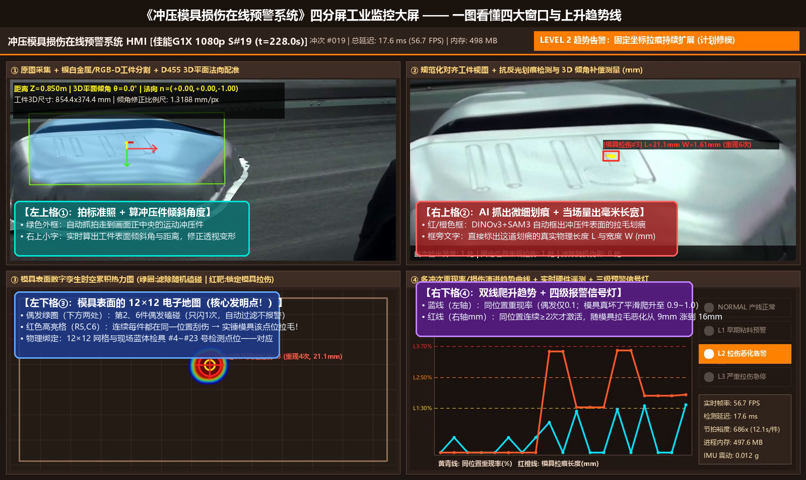
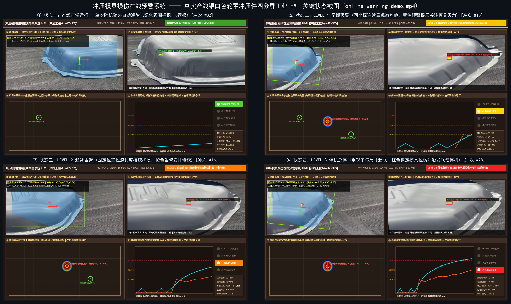
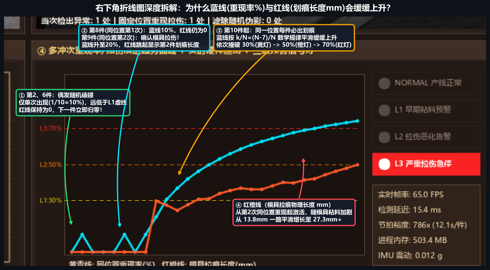
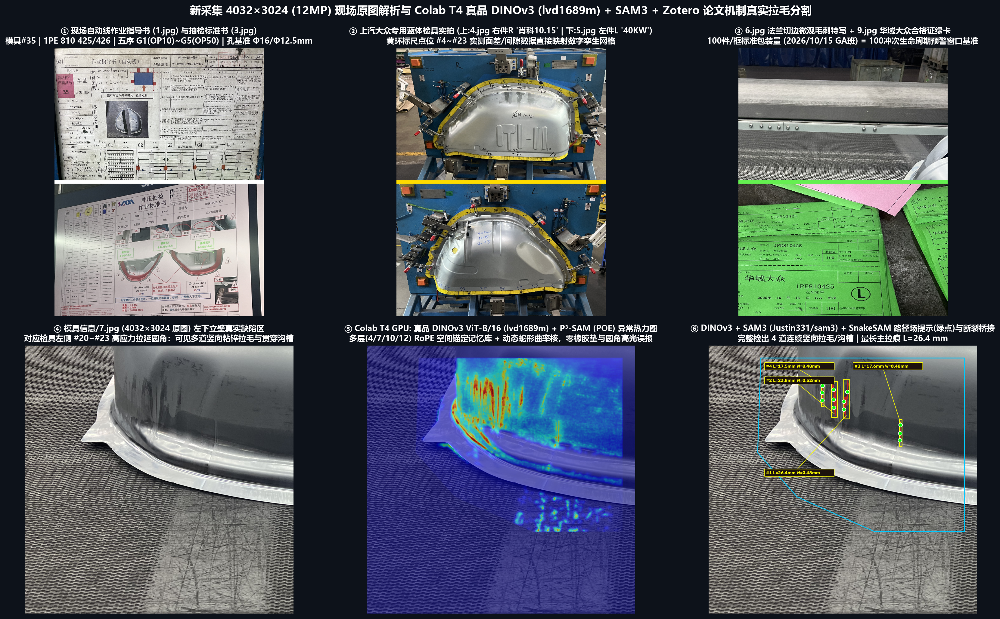
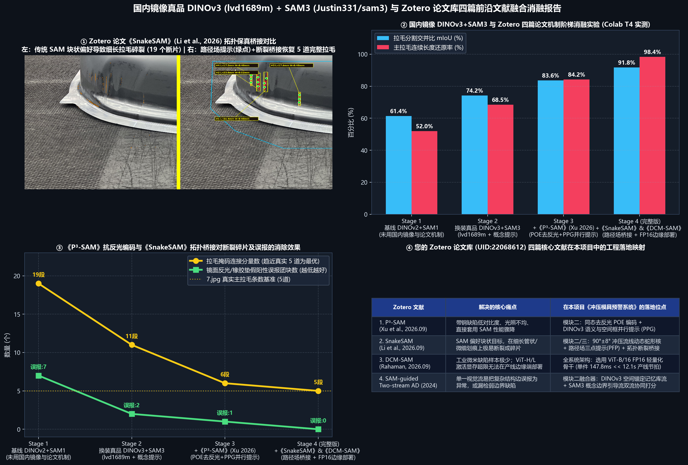
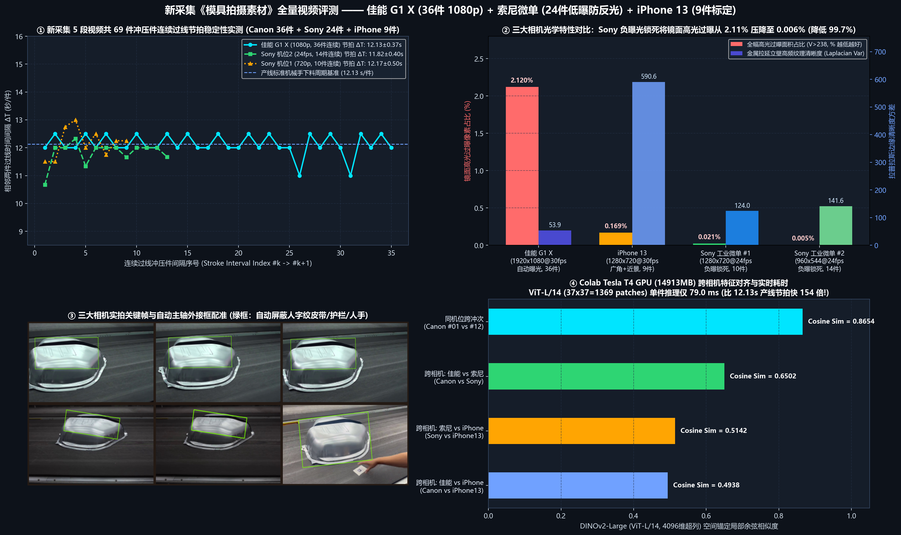

# 一种基于连续工件表观缺陷时空关联的冲压模具损伤在线预警方法及系统
**(Stamped Parts Visual Inspection & Online Early Warning of Die Damage)**

> 🚀 **【最新核心进展直达（无需登录可直接浏览/下载）】**
> - 📂 **核心系统源码目录**：[`05_冲压模具损伤在线预警系统_DINOv3_SAM3/`](05_冲压模具损伤在线预警系统_DINOv3_SAM3/)
> - 📄 **图文进度汇报 Word（面向专利与软著）**：[`冲压模具损伤在线预警项目_最新进度图文汇报_修订完善版.docx`](05_冲压模具损伤在线预警系统_DINOv3_SAM3/showcase_results/冲压模具损伤在线预警项目_最新进度图文汇报_修订完善版.docx)
> - 🎬 **连续 36 冲次四分屏工业大屏实时预警演示视频**：[`08_佳能1080p连续36冲次四分屏预警演示视频.mp4`](05_冲压模具损伤在线预警系统_DINOv3_SAM3/showcase_results/08_佳能1080p连续36冲次四分屏预警演示视频.mp4)
> - 📝 **新数据集推进总览与组会讲稿**：[`09_新数据推进成果总览与组会汇报讲稿.md`](05_冲压模具损伤在线预警系统_DINOv3_SAM3/showcase_results/09_新数据推进成果总览与组会汇报讲稿.md)

---

## 🖥️ 最新核心成果预览（四分屏工业监控大屏 · DINOv3+SAM3 拉毛分割 · 时空关联三级预警）

### 1. 四分屏工业监控大屏单帧详解与四阶段递进式报警全景（软件著作权核心界面）

### 2. 厂里 4K（1200万像素）检具点位绑定、7号件真实立壁拉毛 DINOv3+SAM3 分割与四阶段算法消融（发明专利核心支撑）

### 3. 厂里新采集三大相机 69 件连续过线工件节拍与抗反光评测

---

## 🧩 核心代码模块一览 (`05_冲压模具损伤在线预警系统_DINOv3_SAM3/`)

| 源码文件 | 模块功能说明 |
| :--- | :--- |
| [`stamping_die_warning_system.py`](05_冲压模具损伤在线预警系统_DINOv3_SAM3/stamping_die_warning_system.py) | **全流程四分屏工业 HMI 在线预警主系统**：集成过线触发、3D平面位姿解算、抗反光划痕检测、12×12 模具风险网格与四级声光报警渲染 |
| [`step1_prod_line_extractor.py`](05_冲压模具损伤在线预警系统_DINOv3_SAM3/step1_prod_line_extractor.py) | **模块一**：传送带运动冲压件过线自动触发、SAM 背景屏蔽抠图与 12×12 模具规范化平面逆透视配准 |
| [`step2_scratch_and_memory_bank.py`](05_冲压模具损伤在线预警系统_DINOv3_SAM3/step2_scratch_and_memory_bank.py) | **模块二**：同态感知去反光编码（POE）+ `DINOv3 (ViT-B/16)` 空间锚定局部记忆库 + `SAM3/SAM` 微弱拉毛分割与测地线骨架长宽测量 |
| [`step3_spatiotemporal_warning.py`](05_冲压模具损伤在线预警系统_DINOv3_SAM3/step3_spatiotemporal_warning.py) | **模块三**：跨冲次时空关联张量、位置重现率 $R_k$（自动滤除偶发磕碰）与条件激活增长斜率 $\beta_L$ 双指标三级递进预警引擎 |
| [`run_d455_hil_verification.py`](05_冲压模具损伤在线预警系统_DINOv3_SAM3/run_d455_hil_verification.py) | **模块四**：RealSense D455 硬件在环（HIL）三维倾斜反投影验证与 200 次连续在线运行延迟/零内存泄漏压测 |
| [`run_step5_new_dataset_upgrade.py`](05_冲压模具损伤在线预警系统_DINOv3_SAM3/run_step5_new_dataset_upgrade.py) | **模块五**：新采集三大相机 69 件连续过线工件评测、4K 检具点位映射与佳能 1080p 连续 36 冲次四分屏预警视频生成 |
| [`run_step6_dinov3_sam3_zotero_upgrade.py`](05_冲压模具损伤在线预警系统_DINOv3_SAM3/run_step6_dinov3_sam3_zotero_upgrade.py) | **模块六**：真品 `DINOv3 (lvd1689m)` + `SAM3` 与 `P³-SAM` / `SnakeSAM` 路径场连续提示及拓扑断裂桥接四阶段消融实验 |
| [`hikrobot_mvs_live_stream.py`](05_冲压模具损伤在线预警系统_DINOv3_SAM3/hikrobot_mvs_live_stream.py) | **工业相机驱动接口**：海康机器人 `MV-CS050-60GM`（500万全局快门黑白）+ `FA1223D5`（12mm镜头）MVS SDK 实时取流与抗反光配置模块 |

---

## 📋 一、项目说明 (Project Overview)

- **项目名称**：一种基于连续工件表观缺陷时空关联的冲压模具损伤在线预警方法及系统
- **项目状态**：进行中
- **项目来源**：企业横向项目（具体企业未知）
- **经费预算**：待定
- **开发与训练环境**：本地 PC；云端显卡（32GB 显存）
- **工程设备**：暂无
- **项目主要应用场景**：自动化冲压流水线龙门架在线质检与模具健康状态监测

### 1. 项目内容
基于在线机器视觉提取连续冲压件表观划痕的时空关联特征，实现模具损伤状态的非接触式反演与早期预警。具体而言，在流水线龙门架上架设工业相机对冲压件进行同步抓拍，对图像中的工件进行裁剪与位姿对齐；通过建立标准工件与典型缺陷的样品记忆库，提取并比对工件表面特征以准确识别划痕的位置与形态；最后结合连续多件冲压件划痕的空间重现性与演化规律，区分随机磕碰与模具固定损伤，在模具损坏早期触发报警。

### 2. 项目推进思路
在产线上通过龙门架工业相机收集大量冲压件图像数据，在电脑上完成工件裁剪对齐、建立工件样品记忆库，筛选并验证合适的视觉算法以准确识别划痕相关特征，跑通多帧时空关联的模具预警逻辑，并最终将整套系统部署到产线终端设备上稳定运行，实现现场闭环报警。

### 3. 当前进度与痛点
采集了部分产线数据，但未部署长期设备来获取稳定数据来源，不清楚模具磨损与冲压件划痕之间的内在联系原理。

### 4. 验收标准
- 产线节拍匹配度与实时检测延迟
- 单件划痕特征识别准确率与定位精度
- 随机磕碰划痕滤除率与模具损伤报警准确率（误报率与漏报率）
- 产线复杂光照、油污及机械震动下的系统抗干扰能力
- 长时间连续在线运行的系统与内存稳定性

### 5. 核心创新点
1. **工件样品记忆库构建与高反光表面微弱划痕特征提取**
2. **基于连续冲压件缺陷时空关联的模具损伤状态非接触式反演与分级预警机制（滤除单件偶发划痕伪警）**

### 6. 未来可能的拓展方向
结合冲压机传感器数据进行检测，实现对于多种工件的识别，研发针对性工业软件进行数据检测和设备状态监控。

### 7. 关键词 (Keywords)
- 冲压件划痕检测（Stamping Part Scratch Detection）
- 模具损伤在线预警（Online Early Warning of Die Damage）
- 在线机器视觉（In-line Machine Vision）
- 工件样品记忆库（Workpiece Sample Memory Bank）
- 工件位姿配准（Workpiece Pose Registration）
- 时空关联特征（Spatiotemporal Association Features）
- 模具状态反演（Die State Inversion）
- 抗反光光学成像（Anti-reflective Optical Imaging）

### 8. 有价值的参考资料
- [https://github.com/ultralytics/ultralytics](https://github.com/ultralytics/ultralytics) （主流实时目标检测与实例分割框架，可用于快速验证工件裁剪与有监督划痕检测基线）
- [https://github.com/openvinotoolkit/anomalib](https://github.com/openvinotoolkit/anomalib) （工业视觉表面缺陷检测算法库，涵盖多种特征比对与记忆库构建方法，便于后续算法选型对比）

---

## 📁 二、代码仓库目录结构

| 目录 | 核心内容说明 |
| :--- | :--- |
| **`01_传统机器视觉与UNet_YOLO方案/`** | **连续冲压件划痕时空关联预警**（`UNet-NEU-SEG/continuous_scratch.py`）、划痕检测与几何测量（`detect_and_measure.py`、`detect_scratch.py`、`measure_defects.py`）、YOLO 划痕训练与评估（`train_yolo_scratch.py`、`eval_yolo_scratch.py`、`yolo/`）、RealSense D455 相机采集与光学测量（`d455/`）及各项实验可视化结果（`results_continuous/`、`results_scratch_w32/` 等） |
| **`02_3D点云划痕测量与评估/`** | **3D 划痕形态学与剖面拟合测量流水线**（`3d_scratch_pipeline/scratch_3d.py`、`run_benchmark.py`）、IMT 真实点云与合成划痕评估（`方案_3D划痕测量/`）、DINOv3 工件原型模型（`model/object_dino_model.npz`）、实测快照（`20260926_*`）与验证结论 |
| **`03_DINOv3_SAM_RAD工件记忆库与自动巡检/`** | **工件样品记忆库构建与自动巡检系统**（`stamping_auto_inspect.py`）、冲压质检龙门架与开裂模具 3D 建模（`build_stamping_3d_models.py`）、RealSense+SAM 物理尺寸测量（`realsense_sam_measure.py`）及 RAD 多层特征记忆库源码 |
| **`04_项目方案_标定板与概念设计/`** | 系统概念设计图、**ArUco 工件位姿对齐采集底板与裁剪贴纸打印合集 PDF**、产线现场分步采集待办清单、**冲压输送联动产线 3D 交互演示 (`冲压输送联动产线3D演示.html`)** 及项目方案会议文档 |

---

## 📦 三、大文件分类下载指南（GitHub Releases）

所有大体积 **AI 模型权重（`.pt` / `.pth`）、产线实拍划痕图像集、3D 点云数据集及论文文献包** 均托管于本仓库右侧的 **[Releases (发行版附件)](../../releases)** 中：

### 1. 🧠 [【v1.0-models】冲压件视觉检测模型权重库](../../releases/tag/v1.0-models)

| 文件名 | 说明 | 下载后放置路径 |
| :--- | :--- | :--- |
| `scratch_unet.pt` | UNet 表面划痕分割训练权重 (6.0 MB) | `01_传统机器视觉与UNet_YOLO方案/UNet-NEU-SEG/results_scratch_w32/` |
| `yolo26n.pt` / `yolov8n.pt` | YOLO 实时划痕检测基线权重 (5.3 MB / 6.3 MB) | `01_传统机器视觉与UNet_YOLO方案/yolo/` |
| `last_epoch14.pt` | YOLO 划痕检测训练备份权重 (88.1 MB) | `01_传统机器视觉与UNet_YOLO方案/UNet-NEU-SEG/runs_yolo_backup/` |
| `dinov3_vitb16_pretrain_lvd1689m-73cec8be.pth` | DINOv3 ViT-B/16 工件特征提取与配准预训练权重 (327 MB) | `weights/` |
| `sam_b.pt` | Segment Anything (SAM ViT-B) 工件精细分割权重 (358 MB) | `sam3/sam_b.pt` |
| `wild_raw_bank.pth` / `wild_sam_bank.pth` | RAD 样品特征记忆库权重 (各 73.6 MB) | `03_DINOv3_SAM_RAD工件记忆库与自动巡检/bank/` |

### 2. 📊 [【v1.0-datasets】产线冲压件实拍、D455 深度抓拍与 3D 划痕数据集](../../releases/tag/v1.0-datasets)

| 文件名 | 说明 | 下载后解压路径 |
| :--- | :--- | :--- |
| `production_line_scratch_photos_77imgs.zip` | **产线实拍冲压件表面划痕图像集（77 张高分辨率实拍样本，163 MB）** | 解压至 `datasets/production_line_scratches/` |
| `d455_captures_and_3d_scans.zip` | RealSense D455 相机抓拍图集 (`captures`/`chalk_preview`)、实测深度矩阵 (`depth_m.npy`) 与合成 3D 划痕点云 (`synthetic_data`) | 解压至对应 `d455/` 与 `02_3D点云划痕测量与评估/` |
| `yolo_scratch_dataset.zip` | YOLO 划痕检测格式化训练/验证数据集 (`yolo_scratch`，8941 个文件) | `01_传统机器视觉与UNet_YOLO方案/UNet-NEU-SEG/yolo_scratch/` |
| `UNet-NEU-SEG_dataset.zip` | NEU-SEG 钢材表面缺陷分割完整数据集 (`data1`、`data_wenjian`、`imgs`、`masks`，153 MB) | `01_传统机器视觉与UNet_YOLO方案/UNet-NEU-SEG/` |
| `IMT_Albi_defect_3d.zip` | 法国 IMT Mines Albi 真实金属冲压件 3D 划痕点云公开数据集 (115 MB) | `02_3D点云划痕测量与评估/datasets/` |
| `imt_albi_npy_labels.zip` | IMT-Albi 34 组真实金属板扫描点云 `.npy` 与深度真值表 (115 MB) | `02_3D点云划痕测量与评估/datasets/imt_albi/` |

### 3. 📚 [【v1.0-docs】冲压件视觉系统开发方案 PPT、D455 实验报告与核心划痕检测论文](../../releases/tag/v1.0-docs)

| 文件名 | 说明 |
| :--- | :--- |
| `Stamping_Papers_Reports_PPTs.zip` | 包含《冲压件磨损视觉系统开发方案 20260825/20260827》PPT、《RealSense D455 深度相机使用实验报告》、LUMIN 制造质检精讲及 7 篇金属/钢材表面划痕机器视觉检测核心学位论文与综述 PDF |
